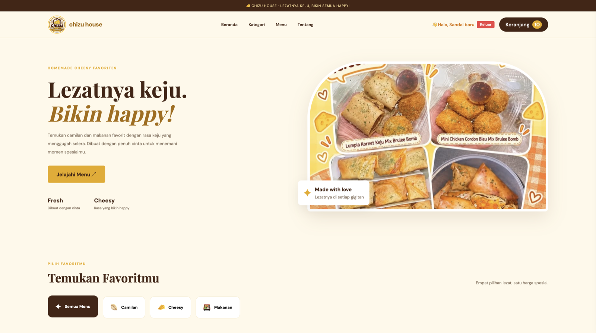
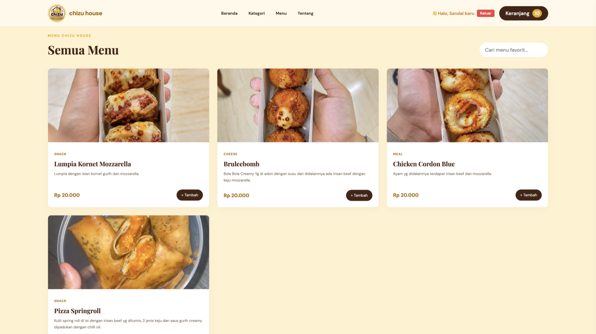
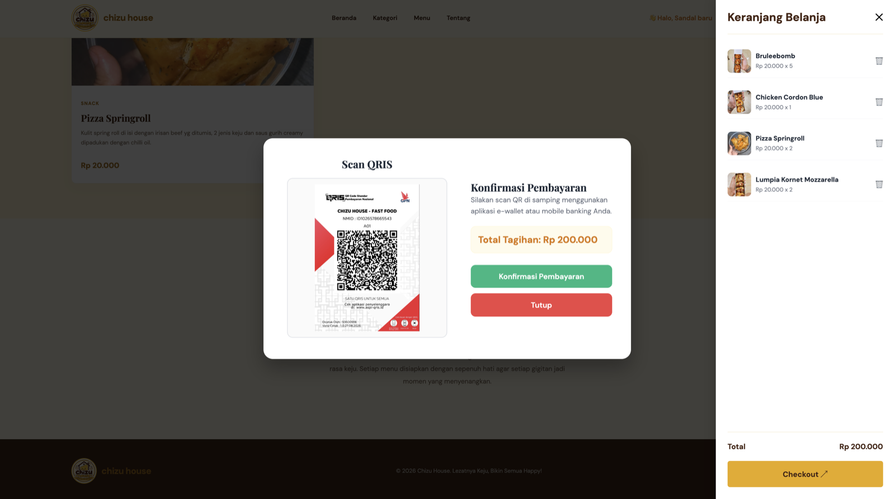

# Chizu House

Website toko makanan Chizu House: katalog produk, keranjang belanja, serta registrasi dan login pengguna.

**Stack:** PHP (mysqli), MariaDB/MySQL, HTML/CSS/JavaScript.

## Preview

**Beranda**



**Daftar menu**



**Keranjang belanja dan pembayaran QRIS**



## Struktur

```
index.php            Halaman utama / katalog
login.php            Form login
login_process.php    Proses login
register.php         Registrasi akun
logout.php           Logout
koneksi.php          Koneksi database
database.sql         Skema database
config.local.example.php  Contoh konfigurasi (default XAMPP)
install.sh           Installer otomatis untuk Ubuntu
css/ js/ assets/     Aset statis
```

Database hanya punya satu tabel, `users`. Produk dan keranjang ada di JavaScript (`js/products.js`, `js/cart.js`).

## Requirement

| Komponen | Versi | Keterangan |
|---|---|---|
| Ubuntu Server | 22.04 / 24.04 | VPS minimal 1 vCPU, 1 GB RAM |
| Apache | 2.4 | Web server |
| PHP | 8.1+ | Ekstensi: `mysqli` (paket `php-mysql`), `mbstring`, `xml` |
| MariaDB | 10.6+ (atau MySQL 8) | Database |
| Git, curl, openssl | - | Dipakai installer |
| Certbot | opsional | HTTPS Let's Encrypt, perlu domain |

Port 80 (dan 443 untuk HTTPS) harus terbuka di firewall VPS dan di panel provider.

## Instalasi di VPS Ubuntu (otomatis)

```bash
ssh root@IP_VPS
git clone https://github.com/khanhecate/chizuhouse.git
cd chizuhouse
sudo bash install.sh
```

Dengan domain:

```bash
sudo DOMAIN=toko.contoh.com bash install.sh
```

Dengan domain dan HTTPS (DNS A record domain harus sudah mengarah ke IP VPS):

```bash
sudo DOMAIN=toko.contoh.com SSL_EMAIL=kamu@email.com bash install.sh
```

Variabel opsional: `APP_DIR` (default `/var/www/chizuhouse`), `DB_NAME` (default `chizuhouse`), `DB_USER` (default `chizu`), `REPO_URL`.

Installer akan:
1. Memasang Apache, PHP, MariaDB, dan dependensinya.
2. Menyalin source code ke `/var/www/chizuhouse`.
3. Membuat database, user database, dan tabel dari `database.sql`. Password database dibuat acak.
4. Menulis kredensial ke `config.local.php` (tidak masuk git, izin 640).
5. Membuat virtual host Apache, menutup akses ke `config.local.php`, `database.sql`, dan `.git`.
6. Membuka firewall `ufw` jika aktif, dan memasang sertifikat HTTPS jika `SSL_EMAIL` diisi.

Script aman dijalankan ulang. Password database yang sudah ada dipakai lagi.

Setelah selesai, buka `http://IP_VPS`, daftar lewat `register.php`, lalu login.

## Instalasi di XAMPP (Windows & macOS)

Untuk menjalankan di komputer lokal tanpa Docker. Unduh XAMPP dengan PHP 8.1 atau lebih baru dari https://www.apachefriends.org.

### Windows

1. Install XAMPP (default `C:\xampp`). Buka **XAMPP Control Panel**, lalu klik **Start** pada **Apache** dan **MySQL**.
2. Taruh project di `C:\xampp\htdocs\chizuhouse`:
   ```bat
   cd C:\xampp\htdocs
   git clone https://github.com/khanhecate/chizuhouse.git
   ```
   Tanpa Git, unduh ZIP dari GitHub lalu ekstrak ke `C:\xampp\htdocs\chizuhouse`.
3. Buat database. Buka http://localhost/phpmyadmin, pilih tab **Import**, pilih file `database.sql` dari folder project, lalu klik **Import**. Database `chizuhouse` dan tabel `users` akan terbuat.
4. Salin `config.local.example.php` menjadi `config.local.php`:
   ```bat
   cd C:\xampp\htdocs\chizuhouse
   copy config.local.example.php config.local.php
   ```
5. Buka http://localhost/chizuhouse/, daftar lewat **Masuk**, lalu login.

### macOS

1. Install XAMPP (`.dmg`, terpasang di `/Applications/XAMPP`). Buka **manager-osx**, tab **Manage Servers**, lalu **Start** pada **Apache Web Server** dan **MySQL Database**.
2. Taruh project di folder htdocs:
   ```bash
   cd /Applications/XAMPP/xamppfiles/htdocs
   sudo git clone https://github.com/khanhecate/chizuhouse.git
   ```
   Kalau Git meminta login karena repo private, pakai token GitHub atau unduh ZIP.
3. Buat database lewat terminal:
   ```bash
   /Applications/XAMPP/xamppfiles/bin/mysql -u root < /Applications/XAMPP/xamppfiles/htdocs/chizuhouse/database.sql
   ```
   Atau lewat http://localhost/phpmyadmin, tab **Import**, file `database.sql`.
4. Salin file konfigurasi:
   ```bash
   cd /Applications/XAMPP/xamppfiles/htdocs/chizuhouse
   sudo cp config.local.example.php config.local.php
   ```
5. Buka http://localhost/chizuhouse/, daftar lewat **Masuk**, lalu login.

### Masalah umum di XAMPP

- **`Koneksi database gagal` atau host `web-project-db` tidak ditemukan:** `config.local.php` belum dibuat (langkah 4). Tanpa file itu, aplikasi memakai default Docker.
- **`Access denied for user 'root'`:** kamu sudah memberi password pada root MySQL. Isi `$pass` di `config.local.php`.
- **`Unknown database 'chizuhouse'`:** `database.sql` belum diimpor.
- **Apache tidak mau start (port 80 dipakai):** di Windows biasanya IIS, Skype, atau World Wide Web Publishing Service. Hentikan layanan itu atau ubah port Apache di `httpd.conf` (`Listen 8080`), lalu buka http://localhost:8080/chizuhouse/.
- **MySQL tidak mau start (port 3306 dipakai):** hentikan MySQL/MariaDB lain yang berjalan di komputer, atau ganti port di `my.ini` (Windows) / `my.cnf` (macOS).
- **Halaman menampilkan kode PHP, bukan website:** buka lewat `http://localhost/...`, bukan dengan klik dua kali pada file `index.php`.

## Instalasi manual

```bash
sudo apt update
sudo apt install -y apache2 mariadb-server git php libapache2-mod-php php-mysql php-mbstring php-xml

sudo git clone https://github.com/khanhecate/chizuhouse.git /var/www/chizuhouse

sudo mysql <<'SQL'
CREATE DATABASE chizuhouse CHARACTER SET utf8mb4;
CREATE USER 'chizu'@'localhost' IDENTIFIED BY 'GANTI_PASSWORD';
GRANT ALL PRIVILEGES ON chizuhouse.* TO 'chizu'@'localhost';
FLUSH PRIVILEGES;
SQL
sudo mysql chizuhouse < /var/www/chizuhouse/database.sql

sudo tee /var/www/chizuhouse/config.local.php >/dev/null <<'PHP'
<?php
$host = 'localhost';
$user = 'chizu';
$pass = 'GANTI_PASSWORD';
$db   = 'chizuhouse';
PHP

sudo chown -R www-data:www-data /var/www/chizuhouse
```

Lalu arahkan `DocumentRoot` Apache ke `/var/www/chizuhouse` (lihat `install.sh` untuk contoh virtual host) dan jalankan `sudo systemctl reload apache2`.

## Konfigurasi database

`koneksi.php` membaca nilai berikut, dengan urutan prioritas dari rendah ke tinggi:
1. Default untuk Docker (`web-project-db`, user `webuser`, database `chizuhouse`).
2. Environment variable `DB_HOST`, `DB_USER`, `DB_PASS`, `DB_NAME`.
3. File `config.local.php` jika ada. Dibuat otomatis oleh `install.sh`, atau salin dari `config.local.example.php` untuk XAMPP.

## Menjalankan dengan Docker (development)

Project ini bisa dijalankan di container PHP+Apache yang terhubung ke MariaDB. Buat database dengan `database.sql`:

```bash
docker exec -i NAMA_CONTAINER_DB mariadb -uroot -pPASSWORD_ROOT < database.sql
```

## Troubleshooting

- **Halaman default Apache muncul:** jalankan `sudo a2dissite 000-default && sudo systemctl reload apache2`.
- **`Koneksi database gagal`:** cek isi `config.local.php` dan status `sudo systemctl status mariadb`.
- **Error `mysqli` class not found:** `sudo apt install php-mysql && sudo systemctl restart apache2`.
- **Log error:** `sudo tail -f /var/log/apache2/chizuhouse_error.log`.
- **Login Gagal / akun tidak terdaftar:** database baru kosong, daftar dulu lewat `register.php`.

## Keamanan

- Ganti password database default jika memakai Docker di server publik.
- Aktifkan HTTPS (`SSL_EMAIL`) karena form login mengirim password.
- Jangan commit `config.local.php`.
